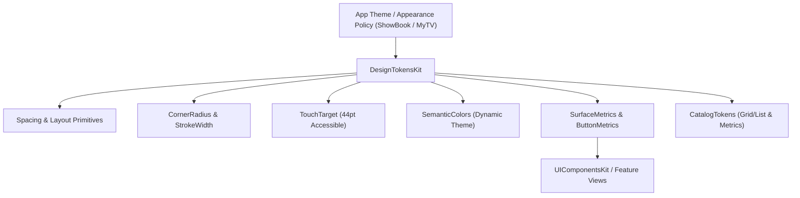

# DesignTokensKit

Design system primitives and geometric design tokens for scalable, multi-app SwiftUI architectures across Anurag Chourasia's portfolio applications (ShowBook, MyTV).


---

## Architecture



`DesignTokensKit` provides the foundation for user interface consistency while respecting the following architectural tenets:
1. **App Ownership of Appearance**: The library does not impose global themes or singletons; each application defines its own branding by configuring token instances.
2. **Zero Sampling & Full Dynamism**: Colors are stored as native SwiftUI `Color` instances without conversion to static RGB, preserving automatic Light/Dark mode and high contrast adaptation.
3. **Exact Point Geometry**: Standardized point scales eliminate magic numbers and ad-hoc padding across views.
4. **Accessible by Default**: Implements Human Interface Guidelines floors, such as `TouchTarget.minimum` (44pt) for interactive elements.

---

## Use Cases

- **Design System Consistency**: Share standardized spacing, corners, and button geometries across multiple standalone apps (e.g., ShowBook and MyTV) without code duplication.
- **Dynamic Theming & Appearance Adaptation**: Build custom components that effortlessly transition between Light Mode, Dark Mode, and high-contrast environments.
- **Accessible Touch Target Enforcement**: Guarantee that all touchable components meet accessibility guidelines (minimum 44x44 pt hit areas).
- **Reusable Component Foundations**: Power higher-level UI packages such as `UIComponentsKit` and `DeveloperProfileKit`.

---

## Practical Code Examples

### 1. Applying Spacing and Corner Radius

```swift
import SwiftUI
import DesignTokensKit

struct InfoCardView: View {
    var body: some View {
        VStack(alignment: .leading, spacing: Spacing.eight) {
            Text("Featured Article")
                .font(.headline)
            Text("Discover the latest design trends and architectural insights.")
                .font(.subheadline)
                .foregroundColor(.secondary)
        }
        .padding(Spacing.sixteen)
        .background(Color(.secondarySystemBackground))
        .cornerRadius(CornerRadius.twelve)
    }
}
```

### 2. Semantic Colors & Surface Metrics

```swift
import SwiftUI
import DesignTokensKit

struct ThemedBanner: View {
    let metrics = SurfaceMetrics(
        cornerRadius: CornerRadius.sixteen,
        borderWidth: StrokeWidth.one
    )
    let colors = SemanticColors(
        surface: Color(.systemBackground),
        foreground: Color.primary,
        border: Color(.separator),
        action: Color.accentColor,
        onAction: Color.white
    )

    var body: some View {
        HStack {
            Text("Status Update")
                .foregroundColor(colors.foreground)
            Spacer()
            Button("Dismiss") {}
                .foregroundColor(colors.action)
        }
        .padding(metrics.padding)
        .background(colors.surface)
        .overlay(
            RoundedRectangle(cornerRadius: metrics.cornerRadius)
                .stroke(colors.border, lineWidth: metrics.borderWidth)
        )
    }
}
```

### 3. Accessible Button Metrics

```swift
import SwiftUI
import DesignTokensKit

struct ActionButton: View {
    let title: String
    let action: () -> Void

    private let metrics = ButtonMetrics(
        cornerRadius: CornerRadius.twenty,
        minimumSize: CGSize(width: TouchTarget.minimum, height: TouchTarget.minimum)
    )

    var body: some View {
        Button(action: action) {
            Text(title)
                .padding(metrics.padding)
                .frame(minWidth: metrics.minimumSize.width, minHeight: metrics.minimumSize.height)
                .background(Color.blue)
                .foregroundColor(.white)
                .cornerRadius(metrics.cornerRadius)
        }
    }
}
```

---

## Release Version Controlling

`DesignTokensKit` adheres strictly to [Semantic Versioning (SemVer 2.0.0)](https://semver.org/spec/v2.0.0.html):

| Release Level | Criteria | Example Tag |
| :--- | :--- | :--- |
| **MAJOR** (`X.0.0`) | Breaking public API changes, removed token definitions | `v2.0.0` |
| **MINOR** (`1.X.0`) | New tokens, additional geometry primitives, enhanced metrics | `v1.2.0` |
| **PATCH** (`1.2.X`) | Bug fixes, internal performance, documentation corrections | `v1.2.1` |

- **Changelog Maintenance**: Every release candidate is documented in [CHANGELOG.md](CHANGELOG.md).
- **Tagging Convention**: All release tags are prefixed with `v` (e.g. `v1.2.0`).
- **Validation**: Verified locally and in CI with `bash Scripts/verify-release-version.sh`.
- **SPM Integration**:
  ```swift
  .package(url: "https://github.com/Anurag-Chourasia/DesignTokensKit.git", exact: "1.2.0")
  ```

---

## Quality & CI Verification

All changes must pass automated pre-merge gates in GitHub Actions:

1. **SwiftLint Verification**:
   - Enforces the organization's pinned 24-rule policy (`.swiftlint.yml`, SwiftLint 0.65.1).
   - Strict mode enabled (`--strict`, no warnings allowed).
   - Run locally: `bash Scripts/lint.sh`.
2. **Build and Test Verification**:
   - Compiles with complete strict concurrency (`-strict-concurrency=complete`) and `-warnings-as-errors`.
   - Host unit tests verifying scalar metrics, color resolution, and layout presets.
   - iOS Simulator build validation via `xcodebuild`.
