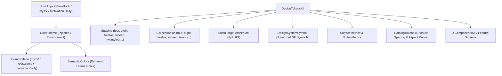
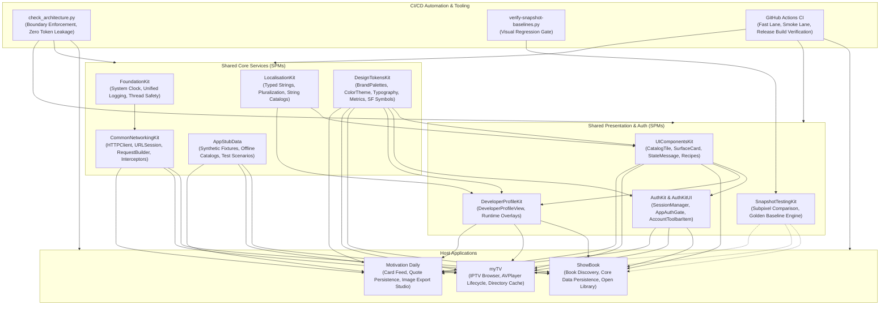

# DesignTokensKit

Design system primitives, geometric design tokens, tokenized iconography, and brand-agnostic color themes for scalable multi-app SwiftUI architectures across the iOS portfolio (**ShowBook**, **myTV**, and **Motivation Daily**).


---

## 1. Executive Summary & Purpose

`DesignTokensKit` serves as the single source of visual truth across the application portfolio. Rather than hardcoding colors, point dimensions, corner radii, or raw SF Symbol strings in application views, applications and shared UI packages consume strongly typed tokens.

### Key Engineering Objectives:
- **Zero Raw Color Literals**: Prevents hardcoded hex/RGB values in feature modules, ensuring consistent dark/light mode adaptation and dynamic accessibility high-contrast support.
- **Brand Palette & Keypath Support**: Applications declare their visual identity via `BrandPalette` and customize themes using Swift KeyPaths (`\BrandPalette.myTV.accent`).
- **Tokenized SF Symbols**: Encapsulates system symbol names in typed enums (`DesignSystemSymbol`), guaranteeing valid icons and preventing typo regressions.
- **Strict Concurrency Compliance**: Built with `-strict-concurrency=complete`. All tokens and themes conform to `Sendable`.

---

## 2. Architecture & Design Principles



### Architectural Tenets:
1. **Dynamic Color Adaptation**: Colors are stored as native SwiftUI `Color` instances without conversion to static RGB, preserving automatic Light/Dark mode and high contrast adaptation.
2. **Accessible by Default**: Implements Human Interface Guidelines floors, such as `TouchTarget.minimum` (44pt) for all interactive surfaces.
3. **Keypath-Driven Customization**: Views can customize semantic roles via Swift KeyPaths without duplicating full palette definitions.
4. **Zero Upstream Dependencies**: Self-contained package depending solely on Apple system frameworks (`SwiftUI`, `Foundation`).

---

## 3. Dependency Graph & Consumer Matrix

| Direction | Package / Project | Responsibility |
|---|---|---|
| **Upstream Dependencies** | *None* | Depends purely on Apple system frameworks (`SwiftUI`, `Foundation`). |
| **Downstream Consumers** | **UIComponentsKit** | Reusable controls consume `Spacing`, `CornerRadius`, `TouchTarget`, and `SemanticColors`. |
| | **AuthKitUI** | Authentication screens consume brand palettes and button metrics. |
| | **DeveloperProfileKit** | Developer profile and social link cards consume typography and tokenized symbols. |
| | **ShowBook** | Book catalog, search filters, and detail views consume `BrandPalette.showBook`. |
| | **myTV** | Channel tiles, player controls, and menus consume `BrandPalette.myTV`. |
| | **Motivation Daily** | Quote card studio, wallpaper browser, and category pills consume `BrandPalette.motivationDaily`. |

---

## 4. API Contracts & Practical Code Examples

### 1. Resolving Themes with Brand Keypaths
```swift
import SwiftUI
import DesignTokensKit

struct ThemedCardView: View {
    // Injected or resolved via environment
    let theme: ColorTheme = .current

    var body: some View {
        VStack(alignment: .leading, spacing: Spacing.eight) {
            Text("Featured Content")
                .font(.headline)
                .foregroundColor(theme.colors.textPrimary)

            Text("Dynamic brand-aware subtitle")
                .font(.subheadline)
                .foregroundColor(theme.colors.textSecondary)
        }
        .padding(Spacing.sixteen)
        .background(theme.colors.surface)
        .cornerRadius(CornerRadius.twelve)
    }
}
```

### 2. Tokenized SF Symbols
```swift
import SwiftUI
import DesignTokensKit

struct NavigationControls: View {
    var body: some View {
        HStack(spacing: Spacing.twelve) {
            Button(action: { /* dismiss */ }) {
                Image(symbol: .close)
                    .frame(minWidth: TouchTarget.minimum, minHeight: TouchTarget.minimum)
            }

            Button(action: { /* share */ }) {
                Image(symbol: .share)
                    .frame(minWidth: TouchTarget.minimum, minHeight: TouchTarget.minimum)
            }
        }
    }
}
```

### 3. Accessible Layout and Button Metrics
```swift
import SwiftUI
import DesignTokensKit

struct PrimaryActionButton: View {
    let title: String
    let action: () -> Void

    var body: some View {
        Button(action: action) {
            Text(title)
                .font(.headline)
                .frame(maxWidth: .infinity)
                .frame(height: ButtonMetrics.primaryHeight) // Standard 50pt height
        }
        .background(BrandPalette.current.accent)
        .foregroundColor(.white)
        .cornerRadius(CornerRadius.eight)
        .frame(minWidth: TouchTarget.minimum, minHeight: TouchTarget.minimum)
    }
}
```

---

## 5. Verification & Testing

The package includes exhaustive unit tests verifying palette integrity, keypath resolution, symbol lookup, and accessibility bounds.

```sh
# Run tests locally
swift test

# Validate architectural boundaries and symbol tokenization
python3 /path/to/UIComponentsKit/Scripts/check_architecture.py --workspace-root /path/to/Projects
```

---

## 6. End-to-End Ecosystem Connectivity



---

## 7. Canonical Notion Dashboards & Governance Links

- [iOS Portfolio — Engineering Tickets Dashboard](https://app.notion.com/p/c20d7f4b133b44499c8ac0b4d5f6249e?pvs=204)
- [iOS Portfolio — Master Document](https://app.notion.com/p/40ffa5f855b98192ad2ede66a5d36fe7)
- [Architecture Boundary Validator (`check_architecture.py`)](file:///Users/anuragchourasia/Desktop/Projects/UIComponentsKit/Scripts/check_architecture.py)
- [Release & Gate Policy Documentation (`Docs/MASTER.md`)](file:///Users/anuragchourasia/Desktop/Projects/Docs/MASTER.md)
